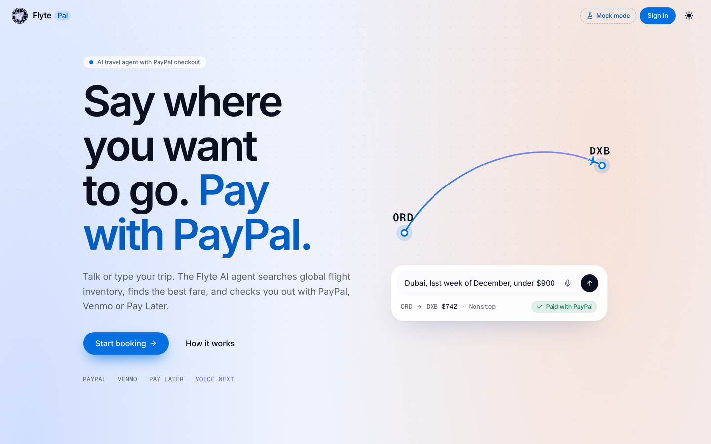

# Flyte Pal

Talk or type where you want to go. The Flyte AI agent searches global flight
inventory, finds the best fare, answers out loud in an ElevenLabs voice, and you
check out with PayPal, Venmo or Pay Later.



Flyte Pal is a web app built on the [Flyte AI](https://flyteai.io) API. You
describe a trip in plain words, watch the agent work through the search live,
get one clear fare card, confirm, and pay with PayPal.

> **Demo bookings.** Bookings made through Flyte Pal are simulated: payments run
> in PayPal's sandbox and no real ticket is issued. Every booking charges $0.01
> in sandbox, whatever the fare shown.

## For judges

1. Open https://pal.flyteai.io and press **Start booking**.
2. Press **Continue as demo traveller**. No account needed. This is one shared
   demo account: everyone trying Flyte Pal sees the same chats and trips, so
   don't type anything private.
3. Ask for a trip, for example `Chicago to Dubai, last week of December`.
   Watch the agent search, then press **Book this flight** and **Yes, confirm**.
   If the agent takes you straight to payment, continue with PayPal.
4. Pay with the PayPal button and log in with the PayPal sandbox buyer:
   - Email: `sb-mvh6f53707432@personal.example.com`
   - Password: in the Devpost testing instructions
   Or press the microphone and say it. The agent answers out loud; talk over
   it any time to cut in. Paying is always a tap on the PayPal button.
5. The boarding pass shows the fare and, separately, the $0.01 sandbox charge.
   Press **View your trips** to see the booking in Flyte Pal's trips screen.

## Run it in 60 seconds (mock mode, no keys)

```bash
git clone https://github.com/ebrahim575/flyte-pal.git
cd flyte-pal
npm install
npm run dev
```

Open http://localhost:3000, press **Start booking**, then **Continue as demo
traveller**. With no backend
configured, Flyte Pal runs on a built-in mock backend: the same streaming
conversation, fare cards and booking flow, with canned fares and a simulated
checkout in place of the PayPal buttons. The header shows **Mock mode**.

Try: `Chicago to Dubai, last week of December`, then **Book this flight**,
then **Yes, confirm**, then approve the payment and open **Your trips**.

## Live mode

Live mode talks to the Flyte AI API (server-to-server, authenticated) and shows
the official PayPal, Venmo and Pay Later buttons in PayPal's sandbox. It needs
the connection settings from your Flyte AI deployment; copy `.env.example` to
`.env.local` and fill them in:

| Variable | Where it's used | What it is |
|---|---|---|
| `FLYTE_BACKEND_URL` | server only | The Flyte AI API. Setting it switches mock mode off. |
| `FLYTE_API_ROUTES` | server only | From your Flyte AI deployment. |
| `FLYTE_API_KEY`, `FLYTE_API_KEY_HEADER` | server only | This deployment's credentials. Never sent to the browser. |
| `FLYTE_CLIENT_IP_HEADER` | server only | Optional, from your Flyte AI deployment. |
| `NEXT_PUBLIC_PAYPAL_CLIENT_ID` | browser | PayPal REST app client id. Public by design. |
| `NEXT_PUBLIC_PAYPAL_ENV` | browser | `sandbox` (default) or `production`. |
| `ELEVENLABS_API_KEY` | server only | Turns on ElevenLabs voice. Works in mock mode too. |
| `ELEVENLABS_VOICE_ID` | server only | Defaults to Kiwi (`VEWZvLXUrFL3O7dUnBSW`). |
| `ELEVENLABS_TTS_MODEL` | server only | Defaults to `eleven_flash_v2_5`, ElevenLabs' ultra-low-latency model. |
| `ELEVENLABS_VOICE_ENABLED` | server only | `false` switches voice off for everyone (typing keeps working). |

Mode is fixed at build time, so rebuild after changing `FLYTE_BACKEND_URL`. If
live mode is switched on but a setting is missing, the server logs which one and
the app says it isn't fully configured.

Everyone comes in as the **demo traveller**: one shared demo account, one click,
no sign-up (simulated in mock mode). Bookings show on Flyte Pal's **Your trips**
screen, each labelled as a demo booking.

### Rate limits

Flyte Pal's own routes are limited per visitor IP: demo sign-in 10 an hour, chat
40 messages per 10 minutes, PayPal order and capture 20 an hour, voice sessions
20 an hour, spoken replies 200 an hour. A visitor over the limit gets a plain
"try again in a little while" message. The counts live in memory, so on Vercel
each warm server instance keeps its own; that is a speed bump, not a guarantee.

## How it works

- **The browser only talks to Flyte Pal's own server.** That server holds the
  credentials, calls the Flyte AI API, and translates every answer into Flyte
  Pal's own shapes (`lib/types.ts`) before the browser sees it. The session
  lives in an httpOnly cookie, and every write route refuses requests from
  other sites.
- **The browser never sends an amount and never calls PayPal's REST API.** The
  Flyte AI API creates the PayPal order and captures it server side. The browser
  renders PayPal's own buttons and passes the order id along.
- **The charge is never confused with the fare.** The amount shown as charged is
  the one on the payment step ($0.01 in sandbox for the hackathon). The fare is
  shown separately.
- **The agent streams progress.** Flyte Pal animates each step as it arrives
  (reading, searching, comparing fares...), then shows the reply, the fare card
  or the payment step.
- **Voice and typing are one conversation.** ElevenLabs realtime speech-to-text
  runs in the browser on a single-use token from `/api/voice/token`; the
  ElevenLabs key never leaves the server. When you pause, the sentence goes into
  the same `send()` as a typed message, so voice can do exactly what typing can
  and no more. Replies are spoken in the Kiwi voice through `/api/voice/speak`
  (ElevenLabs streaming text-to-speech with character timings), and the
  full-screen captions are timed to the audio. Fare cards are said in one
  sentence, summaries say only the question, markdown is never read out.
- **Barge-in.** The mic stays open while the agent speaks. Words that are mostly
  the agent's own (speaker echo) are ignored; anything else stops the voice and
  becomes your next turn. Tapping the orb also cuts in.
- **Voice never pays.** A booking is confirmed only where a typed "yes" would
  be, and payment is always a tap on the PayPal button; the voice stage steps
  aside to show it.
- **Fallbacks.** No ElevenLabs key: the browser's own speech recognition and
  synthesis, where the browser has them, with a note saying so. Microphone
  refused, or no voice at all: a plain message and typing carries on.

## Tech

| Piece | Choice | Why |
|---|---|---|
| Framework | Next.js 16 (App Router), React 19.3, TypeScript | Route handlers proxy the stream; React's `<ViewTransition>` drives route transitions natively |
| UI | Tailwind CSS 4, shadcn/ui, Lucide icons | Owned components, one token set for light and dark |
| Payments | `@paypal/react-paypal-js` (PayPal JS SDK v6) | Official PayPal, Venmo and Pay Later buttons and Pay Later messaging from one order flow |
| Voice | `@elevenlabs/client` (realtime speech-to-text), ElevenLabs text-to-speech, Kiwi voice | Low-latency speech both ways; word timings drive the captions |
| Motion | GSAP (SplitText, DrawSVG, MotionPath) for the hero timeline; Motion for component enter, exit and gestures; CSS for loops and scroll reveals | Each tool owns its own elements; reduced motion is honoured everywhere (add `?rm=1` to force it) |

## Scripts

```bash
npm run dev          # development server
npm run build        # production build
npm start            # serve the build
npm run typecheck
npm run bundle-size  # with the app running on :3000: first-load JS per page, gzipped
npm run screenshots  # with the app running on :3000 in mock mode: drives the full
                     # flow in headless Chromium (desktop and 375px, light and dark),
                     # voice included through a scripted engine (no microphone needed)
```

The screenshot script needs a Playwright Chromium (`npx playwright install chromium`).

## License

MIT. See [LICENSE](LICENSE).
